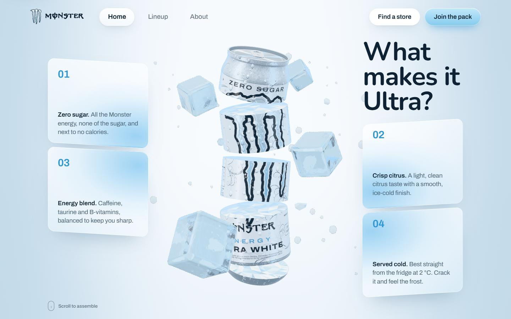
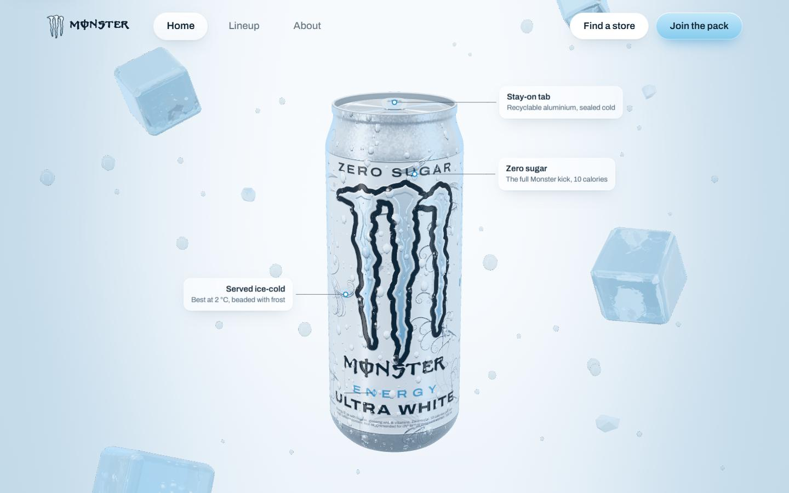
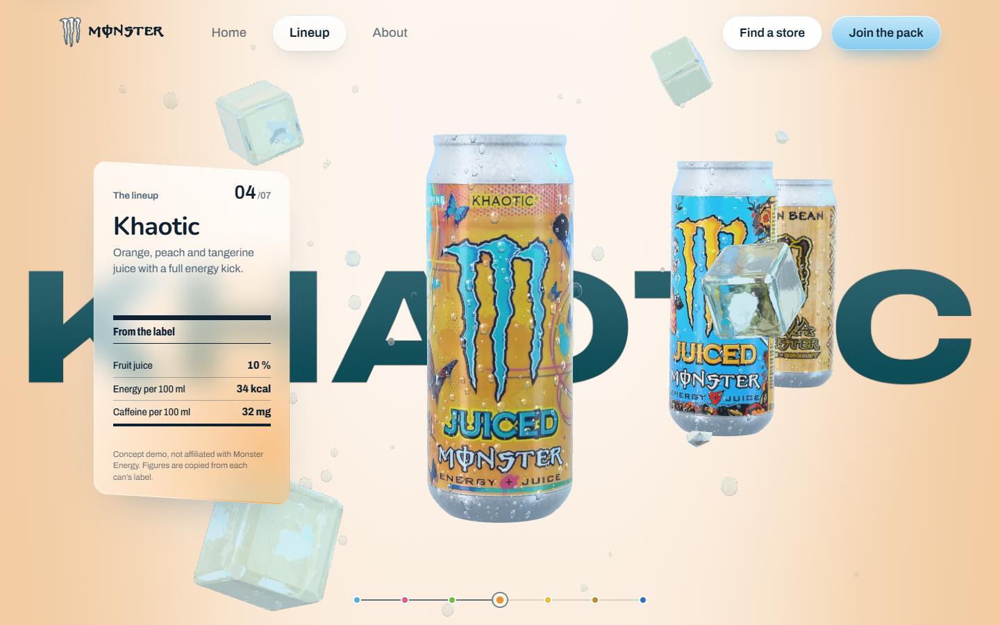
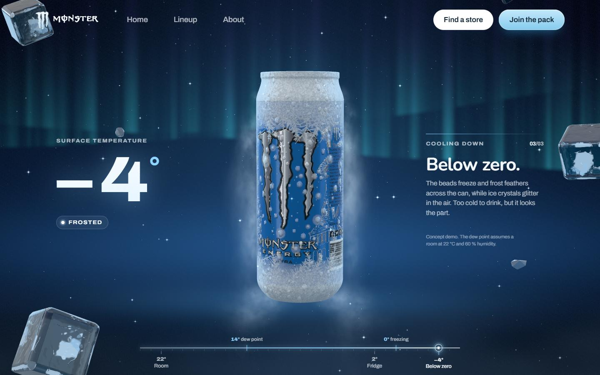
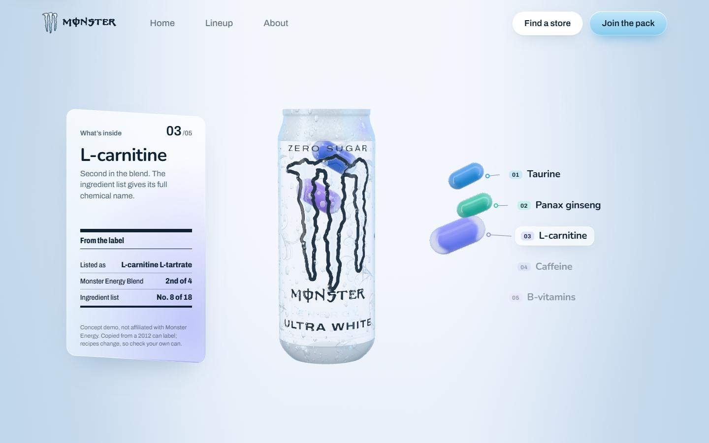
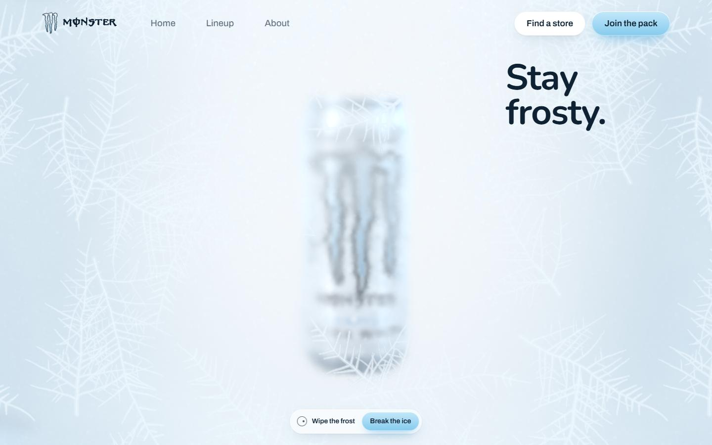
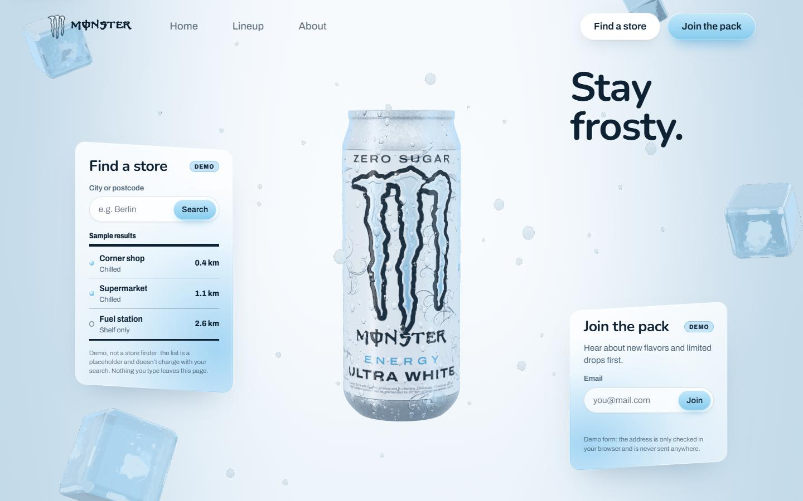
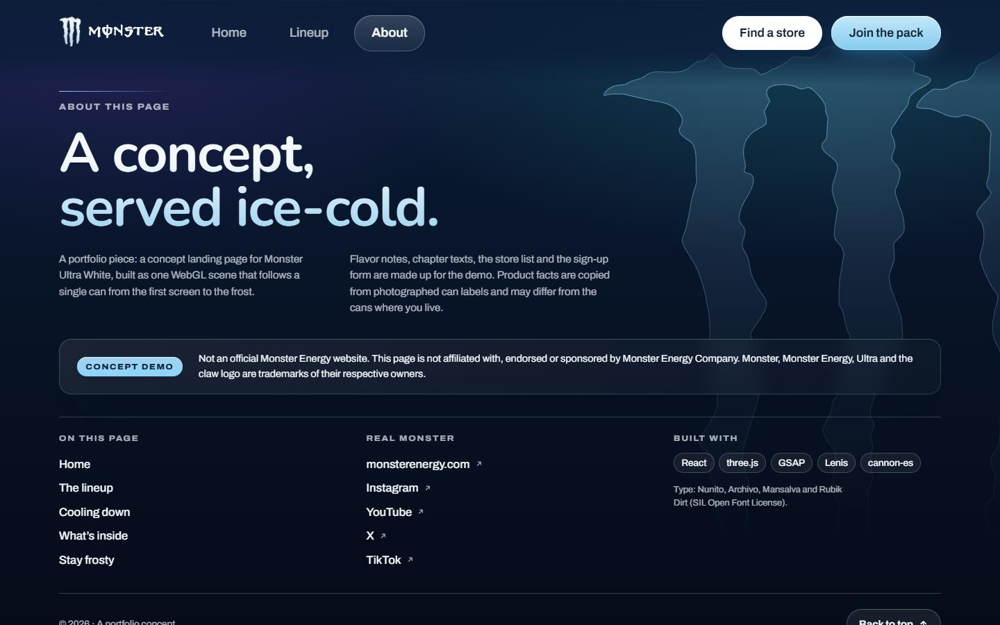

# Monster Ultra White — concept landing page

> **Concept demo and portfolio piece. Not an official Monster Energy website.**
> This project is not affiliated with, endorsed or sponsored by Monster Energy Company.
> Monster, Monster Energy, Ultra and the claw logo are trademarks of their respective owners;
> the logo and can artwork in this repository are used only to illustrate the concept.



A one-page 3D landing for an ice-cold energy drink. One WebGL scene follows a single
procedural can through the whole page: it assembles from slices, turns into a lineup of
flavors, freezes under a polar night, becomes glass to show what is inside, and ends behind
a sheet of frost that you can wipe off or shatter.

## Chapters

| | |
| --- | --- |
|  | **What makes it Ultra?** The can assembles from five slices while the ice drifts away; the camera moves in, callouts follow points on the spinning can, and a huge ULTRA rises behind it. |
|  | **The lineup.** Seven flavors on the same procedural can: flat label unwraps are turned into color, metal and relief maps in a Web Worker and streamed in and out of video memory. The background, ice tint, rim light and the word behind the can change with every flavor. |
|  | **Cooling down.** The only dark chapter. Scrolling cools the can from 22 °C to −4 °C: condensation beads, runs and freezes into frost in a shader on top of the label, while an aurora, frost vapor and diamond dust light up the night. |
|  | **What’s inside.** The can turns to glass and ingredient capsules rise from it, one per stop, to their tags. The facts come from a photographed can label. |
|  | **Stay frosty.** The screen frosts over. Wipe it with the cursor or a finger, press “Break the ice” or keep scrolling: a claw cuts through the frost and the glass shatters into falling shards. |
|  | **Find a store / Join the pack.** Two clearly labelled demo panels: a store search that only shows sample place types, and a sign-up form that validates the address in the browser and sends nothing. |
|  | **About.** A dark footer with the claw silhouette, a note on what the page is, links to the chapters and to the real brand. When it covers the scene, the WebGL loop stops rendering. |

## Stack

- React 19, TypeScript, Vite
- three.js with @react-three/fiber (no drei), custom GLSL patches via `onBeforeCompile`
- GSAP + ScrollTrigger for the scroll scenes, Lenis for smooth scrolling
- cannon-es for the ice physics
- oxlint
- Fonts self-hosted with Fontsource: Nunito, Archivo, Mansalva, Rubik Dirt

There are no glTF or HDR files: the can, the ice, the frost and the studio lighting
(a PMREM of a procedural room) are generated in code. The only bitmap assets are the
flavor label unwraps in `public/labels/`.

## Running it

```bash
npm install
npm run dev       # dev server on http://localhost:5173
npm run build     # type check and production build
npm run preview   # serve the production build on http://localhost:4173
npm run lint      # oxlint
```

## How it is built

- **One canvas, CSS layout.** The canvas sits under the DOM. Every chapter is a section
  with a sticky screen; CSS decides where the can goes (an empty “slot” in the grid), and the
  scene measures the slot and fits the 3D composition into it. All scroll timings live in
  `src/animations/scrollPhases.ts`, shared by the DOM timelines and the scene.
- **DOM ↔ 3D bridge.** Scroll progress, the pointer and slot rectangles are written to a
  plain mutable object (`src/state/motion.ts`) and read in the render loop, without React
  re-renders.
- **Labels and surfaces.** The Ultra White label is drawn procedurally on a canvas; other
  flavors use photographed unwraps processed in a worker. Condensation and frost are a
  shader layer driven by temperature, so every label gets them for free.
- **Performance.** Adaptive pixel ratio, labels loaded only for cans near the current one,
  shaders compiled under the preloader (no compiles mid-scroll), and no rendering while the
  footer covers the scene.
- **Accessibility.** Skip link, visible focus, real text for every on-canvas label, full
  chapter texts for screen readers, keyboard-operable rails and tabs, and a calmer version
  of every chapter with `prefers-reduced-motion`.
- **Layouts.** Desktop, tablet, phone and a separate layout for low landscape screens
  (a phone on its side).

## Facts and texts

Nutrition and ingredient figures are copied from photographed can labels (the Ultra White
ingredient list is from a 2012 label) and may differ from the cans sold today. Flavor notes,
chapter texts, the store list and the sign-up form are written for the demo.

## License

The code is released under the [MIT License](LICENSE). The Monster logo, can artwork and
trademarks belong to Monster Energy Company and are not covered by this license.
